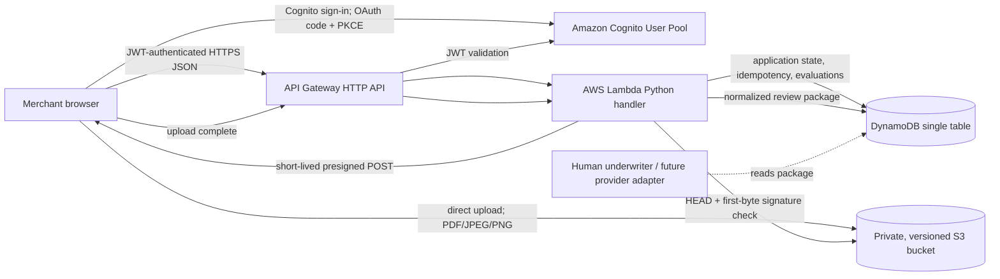

# Architecture and operating notes

## Request path

Application compute runs in Lambda. API Gateway provides HTTPS ingress, DynamoDB holds compact workflow state, and S3 holds files. CloudWatch receives structured logs with configurable retention and low-cardinality Embedded Metric Format request, duration, and failure metrics. Large document bodies never pass through Lambda. The browser asks Lambda for a restricted presigned POST, sends the file to S3, then confirms completion. The completion handler checks the declared size/type and file signature before marking the document received.

## State and keys

The table uses `PK` + `SK` and on-demand billing. An application's partition key is `APP#{uuid}`. Sort keys are `META`, `DOC#{uuid}`, `EVAL#{uuid}`, and `SUBMISSION#{version}`. A create idempotency row uses `IDEMPOTENCY#{deterministic UUID}` with a TTL. Conditional writes on application `version` reject stale edits rather than silently overwriting them. Reads for a single application's review are strongly consistent. Each application is capped at 50 document records and 40 evaluation snapshots so a partition cannot grow without bound.

Documents move through `UPLOADING` to `RECEIVED`, or to `UPLOAD_EXPIRED` when completion arrives after the five-minute link expires. Replacing a received same-type document for the same person transitions the earlier record to `SUPERSEDED`. After application submission, a Cognito user in `underwriting-reviewer` may transition a document from `RECEIVED` to `PROCESSING`, then to `ACCEPTED`, `NEEDS_REVIEW`, or `REJECTED`; `NEEDS_REVIEW` and `REJECTED` require a reason. Each transition records actor subject, source, request ID, and time. Same-result retries do not append duplicate events. Evaluations are append-only snapshots. Submissions preserve a normalized payload and set the application to `SUBMITTED`; applicant writes are rejected. A submission is pending human review. There is no reviewer dashboard or document-download route yet.

## Time budget and failures

The Lambda timeout is 40 seconds and the application internal budget is 35 seconds, leaving headroom beneath the assessment's 45-second maximum. AWS SDK connection and read timeouts are 2 and 3 seconds with retries disabled. Routes make at most five bounded S3/DynamoDB calls; the complete-upload route is the maximum and may read at most 10 MB. Per-application DynamoDB review queries are capped at 100 records so work cannot grow without bound. A slow dependency returns a safe error; clients can retry idempotent create requests, and writes use conditional versions. If evaluation later requires a slower external provider, move it to an asynchronous Lambda-triggered workflow and have the browser poll an evaluation status route rather than keeping the HTTP request open.

## Security decisions and known gaps

- The S3 bucket blocks public access, uses server-side encryption and versioning, denies non-TLS requests, and grants the function only object read/write access below the application's key prefix. Upload sizes and types are constrained in the signed policy; short-lived URLs are bearer credentials.
- A limited first-byte signature check validates PDF/JPEG/PNG. Malware scanning, quarantine, full document inspection, and OCR require an asynchronous processing stage before a reviewer trusts the file.
- The application does not accept PAN/CVV or raw government-ID, tax, or bank-account numbers. It accepts only masked/last-four metadata. Logs omit request bodies and document content.
- Cognito hosted sign-in requires TOTP MFA; an API Gateway JWT authorizer protects API routes. The API stores the authenticated Cognito subject as the application owner and checks it for every application operation. The frontend uses OAuth authorization code with PKCE. Verify the hosted sign-in and MFA flow in the deployed environment before any wider use.
- API Gateway applies a default 25 requests/second and 50-request burst limit and writes access logs without application identifiers, user IDs, IP addresses, or payloads. The application caps requests and record growth; these controls do not replace per-user quotas, WAF/bot protection, or alarms.
- API Gateway and S3 CORS use a `FrontendOrigin` parameter; its default is a safe nonfunctional placeholder. Set it to the exact HTTPS frontend origin for deployment.
- SSE-S3 is configured for the prototype. A production data-protection review should decide KMS key ownership, rotation, audit access, backup restoration, and retention. An hourly cleanup Lambda is included, but its empty default `RetentionPolicy` disables deletion until compliance approves status-specific periods. It deletes document versions/delete markers before DynamoDB records, handles one application per invocation, and retries partial work on later runs. Legal holds and a separate deletion audit record are not implemented. Presigned upload links expire independently of stored-object retention.
- The included MCC catalog contains the 924 distinct four-digit Visa MCC/title entries extracted from Section 2 of the April 2026 Visa Merchant Data Standards Manual; provenance and edition are recorded in `src/mcc_catalog_metadata.json`. The applicant can search the entire list by code or title. Activity-based suggestions remain a smaller curated keyword set and can return no match; no default MCC is fabricated. Visa MCC definitions are separate from acquirer eligibility policy, which must be configured for each provider.
- The demo mode is a frontend-only simulation using local browser storage. It never uploads actual files and must contain sample data only.
